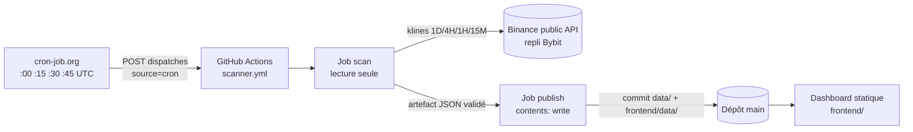

# TR_opti — Spécifications techniques

Version : novembre 2026.

## 1. Pile technique

| Élément | Choix |
|---|---|
| Moteur | Python 3.11 / 3.12, **bibliothèque standard uniquement** (aucune dépendance d'exécution). |
| Interface | HTML / CSS / JavaScript natif, sans framework ni bibliothèque. |
| Exécution | GitHub Actions (runners `ubuntu-latest`), dépôt public. |
| Planification | cron-job.org → API GitHub `workflow_dispatch` (toutes les 15 min). |
| Données de marché | API publiques Binance USDⓈ-M (sans clé), repli Bybit. |
| Stockage | Fichiers JSON versionnés dans le dépôt (`data/` et miroir `frontend/data/`). |
| Hébergement du dashboard | Statique (`frontend/`) sur Cloudflare Pages, redéployé uniquement sur changement de code (`frontend/data/*` exclu des chemins surveillés). Les JSON sont lus sur `raw.githubusercontent.com` (balise `<meta name="data-source">`), avec repli sur `data/` local. |

## 2. Architecture et flux



Déroulé d'un scan (`scanner/main.py`, `scan_once`) :
1. Chargement de la configuration et des données précédentes (`signals.json`, `system-status.json`…).
2. Collecte des bougies (fenêtres : 1D 230, 4H 260, 1H 300, 15M 500) et du contexte dérivés (funding, open interest).
3. Analyse (`analysis.analyze_symbol`) : indicateurs, structure, SMC par unité de temps.
4. Génération (`signals.generate_signals`) : évaluation LONG et SHORT, score, publication éventuelle.
5. Cycle de vie (`outcomes.update_outcomes`) : déclenchement, TP/SL, expiration, limite de durée.
6. Performance (`performance.compute_performance`), validation (`validation`), écriture atomique des JSON.

## 3. Arborescence

| Chemin | Rôle |
|---|---|
| `config/strategy.json` | Tous les paramètres de stratégie (fusionnés sur les valeurs par défaut de `scanner/config.py`). |
| `scanner/main.py` | Orchestrateur de scan et CLI (`python -m scanner.main`). |
| `scanner/market_data.py` | Client HTTP résilient (repli, reprises, limites, dialecte Bybit). |
| `scanner/universe.py` | Construction de l'univers top-100 (non utilisé en production BTC-only). |
| `scanner/indicators.py` | EMA, RSI, ATR, ADX/DI, volume relatif, VWAP glissant. |
| `scanner/structure.py` | Swings confirmés, BOS/CHoCH, déplacements, sweeps, niveaux égaux. |
| `scanner/smc.py` | Fair Value Gaps, Order Blocks (fraîcheur, mitigation, invalidation). |
| `scanner/analysis.py` | Analyse multi-unités de temps, biais et régime. |
| `scanner/scoring.py` | Score, paliers, mode pondéré (`is_weighted`, `quality_tier`, `effective_min_rr`). |
| `scanner/risk.py` | Déclencheur, zone, stop, objectif, gain/risque, contrôle des coûts. |
| `scanner/signals.py` | Modèles strict et pondéré, déduplication, construction des propositions. |
| `scanner/outcomes.py` | Cycle de vie chronologique, résolution 1 min des cas ambigus (en direct). |
| `scanner/costs.py` | Frais taker et funding exprimés en R. |
| `scanner/performance.py` | Statistiques, calibration Wilson, Monte Carlo par blocs. |
| `scanner/validation.py`, `validate_data.py` | Intégrité des données, non-repeinture, CLI de validation. |
| `scanner/persist.py` | Écritures atomiques, chemins confinés, miroir `frontend/data/`. |
| `scanner/replay.py` | Replay / backtest causal, historique mensuel, fusion dans l'historique. |
| `scanner/diagnose.py` | Entonnoir de rejet et sensibilité des seuils (hors ligne). |
| `scanner/check_docs.py` | Vérifie que le README correspond à la réalité (CI). |
| `scanner/build_offline.py`, `build_preview.py` | Dashboards autonomes générés localement (non versionnés). |
| `scanner/network_security.py`, `html_security.py` | Liste blanche réseau, protection des scripts inline. |
| `.github/workflows/` | `scanner.yml`, `tests.yml`, `security.yml`. |
| `.github/scripts/publish_data.py` | Publication contrôlée des fichiers générés. |
| `frontend/` | `index.html`, `app.js`, `styles.css`, `_headers`, `data/`. |
| `tests/` | Tests unitaires et d'intégration hors ligne + contrôles frontend. |

## 4. Configuration (`config/strategy.json`)

| Section | Paramètres clés |
|---|---|
| `scan` | `intervalMinutes` 15, `scheduleMinutesUtc` [0, 15, 30, 45], `timezone` UTC. |
| `dataSource` | Chaîne de repli, timeout 12 s, 3 reprises, 700 requêtes max par scan, fenêtres de bougies. |
| `indicators` | EMA 20/50/200, RSI 14, ADX 14, ATR 14, volume relatif 20, VWAP 48. |
| `structure`, `smc` | Swing 2 bougies, déplacement 1,5 ATR, FVG ≥ 0,1 ATR, fenêtre de setup 12 bougies. |
| `signalModel` | `mode` (`weighted` / `strict`), zones RSI, ADX min 15, volume min 1,2, ATR % 0,10–3,0. |
| `risk` | Tampon déclencheur 0,1 ATR, zone 0,5 ATR, tampon stop 0,5 ATR, stop 0,15–3,5 ATR, `minRr` 2,5 (strict), `preferredRr` 3. |
| `costs` | 0,05 % par côté, funding activé, coût max 0,25 R. |
| `scoring` | Seuils A+ 90 / A 85 / B+ 80, poids des familles. |
| `weighted` | `minScore` 50, `bThreshold` 70, `minRr` 1,5, `fallbackRr` 2, `cooldownMinutes` 60, `contextWeight` 10. |
| `lifecycle` | Expiration du déclencheur 12 bougies (3 h), durée max du trade 16 bougies (4 h). |
| `dedupe`, `retention`, `sessions`, `derivatives`, `bias1d`, `performance` | Déduplication, rétention (288 instantanés, 200 logs), séances, contexte dérivés, Monte Carlo. |

`Config.validate()` contrôle la cohérence (seuils, gain/risque, coûts, hôtes autorisés, mode).

## 5. Données publiées

| Fichier | Contenu |
|---|---|
| `signals.json` | `{generatedAt, signals[]}` — toutes les propositions (en direct et `dataSource: "replay"`). |
| `performance.json` | Statistiques globales, par sens / palier / régime, calibration, Monte Carlo. |
| `system-status.json` | Dernier scan (horaires, déclencheur, santé, API), créneaux, logs. |
| `market-snapshots.json` | Instantanés de marché (rétention 288). |
| `latest-chart.json` | Bougies 15 min et niveaux pour le graphique BTC. |
| `universe-snapshot.json` | Tableau de l'univers scanné. |
| `trend4h-paper.json` | État de la simulation Tendance 4H : capital, positions, ordres en attente, trades, cassures évaluées, situation par crypto (`watch`), courbe de capital, statistiques, dernier passage. |
| `ai-analyst.json` | Analyste IA en test : avis par clôture 4H, notation, statistiques, dernier passage. |
| `trend-combo-paper.json` | Second portefeuille (4H + renfort 1H) : `book4h`, `book1h` (même forme que la Tendance 4H), capital commun, courbe et statistiques. |
| `ai-combo.json` | Analyste IA dédié au second portefeuille (même forme que `ai-analyst.json`, avis `breakout4h` / `breakout1h`). |
| `frontend/data/badge.json` | Badge d'état (heure UTC, santé). |

Champs principaux d'une proposition : `id`, `symbol`, `direction`, `timeframe`, `quality`, `score`,
`components`, `generatedAt`, `triggerPrice`, `entryZone`, `stopLoss`, `takeProfit`, `riskReward`,
`targetKind`, `structure`, `liquiditySweep`, `fvg`, `orderBlock`, indicateurs, biais, `status`,
`expiryAt`, `triggeredAt`, `entryPrice`, `closedAt`, `rMultiple`, `costR`, `rMultipleNet`, `dataSource`.
Les champs de définition (prix, niveaux, biais, horaires) sont **immuables** après publication.

## 6. Ordonnancement et CI/CD

### 6.1 Planification
- cron-job.org (fuseau UTC, expression `0,15,30,45 * * * *`) envoie
  `POST /repos/cfr6fpxy8c-svg/TR_opti/actions/workflows/scanner.yml/dispatches`
  avec `{"ref":"main","inputs":{"source":"cron"}}` ; réponse attendue **204**.
- Jeton GitHub *fine-grained* limité au dépôt, permission **Actions : Read and write**,
  stocké uniquement dans cron-job.org (jamais dans le dépôt).
- La planification native GitHub (`schedule`) ne délivrait aucune exécution sur ce dépôt ; elle n'est
  plus utilisée pour le scanner.

### 6.2 Workflows

| Workflow | Déclencheurs | Contenu |
|---|---|---|
| `scanner.yml` | `workflow_dispatch` (source `manual`/`cron`), push sur `scanner/**`, `config/**` | Job **scan** (lecture seule + `id-token: write` pour GCP) : scan BTC, simulation Tendance 4H, analyste IA, validation, artefact. Job **publish** (`contents: write`) : copie de la liste blanche de fichiers, commit `github-actions[bot]`, push avec reprise. `SCAN_TRIGGER=schedule` si `source=cron`. |
| `tests.yml` | push, pull request, manuel | Outils QA verrouillés par hash, contrôles frontend, pytest (3.11, 3.12), compilation, validation des données, cohérence du README. |
| `security.yml` | push, pull request, manuel, planification hebdomadaire GitHub (non fiable sur ce dépôt) | Bandit, pip-audit, contrôles frontend, actionlint, gitleaks (binaires vérifiés par SHA-256). |
| Dependabot | hebdomadaire | Mises à jour pip et GitHub Actions. |

Actions épinglées par SHA de commit ; permissions par défaut en lecture seule.

## 7. Sources de données et résilience

Chaîne de repli : `fapi.binance.com` → `www.binance.com/fapi` → `data-api.binance.vision` (spot) →
`api.bybit.com` (traduit au format Binance). Les runners GitHub reçoivent souvent **HTTP 451** de
`fapi.binance.com` ; le miroir `www.binance.com` est alors utilisé. Reprises avec temporisation
exponentielle, détection des limites de débit, taille de réponse bornée, aucune donnée inventée :
en cas d'échec, l'état « dégradé » ou « échec » est publié et les dernières données valides conservées.

## 8. Algorithmes

### 8.1 Analyse
- Bougies **clôturées uniquement** ; swings confirmés après 2 bougies (aucune anticipation).
- Biais par unité de temps : empilement EMA 20/50/200 + ADX ; régime 4H (tendance / range / mixte).

### 8.2 Mode pondéré (`signals._try_weighted_setup`)
1. Blocages : indicateurs manquants, ATR invalide, ATR % hors plage.
2. Recherche facultative (fenêtre 12 bougies) : sweep, BOS/CHoCH, déplacement, FVG, OB valides.
3. Niveaux : déclencheur = plus haut de confirmation + 0,1 ATR (LONG) ; invalidation = plus bas de la
   fenêtre (ou niveau balayé), plafonnée pour que le stop reste < 3,5 ATR ; stop = invalidation − 0,5 ATR.
4. `risk.build_setup` : contrôle du coût (≤ 0,25 R), objectif = structure la plus proche ≥ 1,5 R,
   sinon 2 R fixe (`targetKind: fixed_rr`).
5. `scoring.score_setup` : points par famille + contexte, total ramené sur 100 ; `quality_tier`.
6. `generate_signals` : meilleur sens conservé (`weaker_direction` pour l'autre), une proposition
   active maximum, délai 60 min, déduplication par empreinte du setup.

### 8.3 Cycle de vie (`outcomes`)
Parcours chronologique des bougies 15 min postérieures : déclenchement (gap → prix d'ouverture),
TP/SL, ambiguïté résolue en 1 min en direct (sinon `AMBIGUOUS`), expiration, limite de durée
(`CANCELLED`, clôture au marché). Coûts (frais + funding) en R, résultat net séparé du brut.

### 8.4 Statistiques (`performance`)
Taux de réussite (gagnées / résolues), profit factor, espérance, Sharpe en R, séries, drawdown,
calibration par palier avec **intervalle de Wilson 95 %**, Monte Carlo par blocs (conserve les séries
de pertes), tout en brut et en net.

### 8.5 Tendance 4H en simulation (`scanner/trend4h.py`)
- Étape distincte du workflow (`python -m scanner.trend4h`, `continue-on-error`), indépendante du scan
  BTC 15 min ; configuration `trend4h` (validée par `Config.validate`).
- À chaque passage : bougies 4H (`klineLimit` = 1 000) des symboles + `trendSymbol`, taux de
  financement (`premiumIndex`, un appel). `step()` est une fonction pure : elle traite dans l'ordre
  chronologique toutes les bougies clôturées après `lastBarClose[symbole]` (rattrapage des scans
  manqués, aucun doublon en cas de relance).
- Par bougie : exécution des entrées en attente à l'ouverture, gestion de la position (stop sur
  plus haut / plus bas, prix d'ouverture en cas de saut après la bougie d'entrée ; sortie suiveuse
  sur la clôture à partir de la bougie suivant l'entrée), puis évaluation d'une cassure (pas sur la
  bougie de sortie) avec filtres tendance / volume / financement et limites positions / levier.
- Premier passage : point de départ fixé à l'avant-dernière bougie clôturée (pas de backfill).
- Trades fantômes : chaque cassure évaluée (prise ou écartée) reçoit `shadow`, suivi avec les mêmes
  règles d'entrée, de stop et de sortie suiveuse, sur bougies clôturées uniquement, sans capital ni
  financement (`rNet` après frais et glissement). `shadowStats` agrège prises / écartées. Les
  1 000 dernières cassures sont conservées.
- `watch[symbole]` : cours, canal des `channelBars` dernières bougies clôturées (niveaux à casser),
  volume relatif et financement de la dernière bougie, sens de `trendSymbol`, et dimensionnement
  d'un trade immédiat (distance du stop, risque, notionnel, levier), et `candles` (60 dernières
  bougies 4H clôturées + bougie en cours, `[openTime, open, high, low, close]`) ; alimente les cartes
  et graphiques du dashboard.
- Si le flux de `trendSymbol` est indisponible, aucune bougie n'est consommée ; l'état est conservé
  avec `lastRun.status = "degraded"`.
- Résultat d'un trade : `R brut − 2 × (frais + glissement) × entrée / risque`, moins le financement
  cumulé ; le capital réalisé sert de base au risque suivant.
- Le moteur reproduit à l'identique le backtest de recherche sur la même période (contrôle effectué
  sur les 30 derniers jours au déploiement).

### 8.6 Analyste IA (`scanner/ai_analyst.py`)
- Étape distincte après la Tendance 4H (`continue-on-error`, 5 min max). Authentification sans clé :
  `google-github-actions/auth` (épinglée) échange le jeton OIDC GitHub (`id-token: write`, job scan
  uniquement) via Workload Identity Federation contre un jeton d'accès de 10 min du compte de service
  `trend-ai` (rôle `roles/aiplatform.user` seul, pool limité à ce dépôt et à `main`). Aucun fichier
  d'identifiants n'est écrit. Secrets : `GCP_PROJECT`, `GCP_WIF_PROVIDER`, `GCP_SA`. Sans secrets,
  l'étape publie `status = "not-configured"`.
- Appel Vertex AI `generateContent` (modèle `aiAnalyst.model`, outil `googleSearch`), sans redirection,
  réponse ≤ 2 Mo ; identifiants projet / région / modèle validés par expressions régulières avant
  construction de l'URL.
- Une analyse par clôture 4H (`watch.barClose`) ; ignorée si la clôture date de plus de
  `maxDelayMinutes` ; au plus `maxAttemptsPerBar` essais.
- Réponse du modèle traitée comme non fiable : JSON extrait puis validé (symboles connus seulement,
  directions et décisions dans une liste fermée, probabilités bornées 0-100, textes tronqués), sources
  conservées seulement en `https://`. Le dashboard échappe tout texte et n'émet que des liens https.
- `ai-analyst.json` : analyses (avis par crypto, cassures, trade proposé et son statut, requêtes,
  sources, forme des métadonnées de recherche, jetons consommés), `portfolio` (positions et trades de
  l'IA, simulés sur `watch.candles` clôturées : stop prioritaire sur l'objectif dans une même bougie,
  prix d'ouverture en cas de saut, sortie à la clôture à la durée maximale ; risque `trend4h.riskPct`
  du capital réalisé, coûts `takerFeePct` + `slippagePct` × 2),
  notation (`outcome` à 24 h depuis `watch.candles`, `ours` / `result` depuis le trade fantôme),
  `stats` (réussite, Brier, tableau prise/écartée × GO/NO-GO). Au-delà de 7 jours les textes sont
  retirés ; 1 200 analyses conservées.

### 8.7 Second portefeuille 4H + renfort 1H (`scanner/trend_combo.py`, `scanner/ai_combo.py`)
- Modules distincts, copies volontaires de `trend4h.py` et `ai_analyst.py` : la simulation et l'IA de la
  Tendance 4H ne sont ni import\u00e9es ni modifi\u00e9es. \u00c9tapes s\u00e9par\u00e9es du workflow (`continue-on-error`), avec
  leur propre jeton GCP (`gcp2`).
- `trend_combo` : bougies 4H (`trend4h.klineLimit`) et 1H (`trendCombo.h1KlineLimit`), un appel
  `premiumIndex`. Livre 4H = r\u00e8gles `trend4h` avec `risk4hPct` ; livre 1H = m\u00eames filtres avec
  `h1ChannelBars` / `h1TrailBars` / `h1StopAtr` et `risk1hPct`, tendance BTC = derni\u00e8re bougie 4H cl\u00f4tur\u00e9e
  \u00e0 la cl\u00f4ture 1H, entr\u00e9e autoris\u00e9e seulement si le livre 4H d\u00e9tient la crypto dans le m\u00eame sens \u00e0 cet
  instant (motif sinon : \u00ab pas de position 4H ouverte dans ce sens \u00bb). Les deux livres dimensionnent sur
  le capital commun r\u00e9alis\u00e9 (`startCapital` + gains r\u00e9alis\u00e9s des deux livres) ; le plafond de levier
  s'applique par livre.
- `ai_combo` : m\u00eames r\u00e9glages que `aiAnalyst` (`trendCombo.aiEnabled`), analyse \u00e0 chaque cl\u00f4ture 4H et \u00e0
  chaque cl\u00f4ture 1H portant une cassure de l'un des livres ; notation des directions et portefeuille IA
  sur bougies 1H (`book1h.watch.candles`).

## 9. Replay / backtest (`scanner/replay.py`)

```bash
python -m scanner.replay --symbols BTCUSDT --candles 2880 --into-history
```
- Historique paginé (pages de 1 000 bougies) ; `--candles` = nombre de pas 15 min (2 880 ≈ 30 jours).
- À chaque pas, seules les bougies clôturées sont visibles, avec **la même fenêtre que le direct**
  (fenêtres de bougies de la configuration) : indicateurs identiques au live.
- Sortie : propositions, performance, **entonnoir** (évaluations, propositions, motifs de rejet).
- `--into-history` : remplace la partie replay de `signals.json` par les propositions **terminées**
  antérieures à la première proposition en direct, puis recalcule `performance.json`.
- `--determinism-check` : deux exécutions identiques doivent produire le même résultat.

## 10. Sécurité

- Réseau : liste blanche d'hôtes et de chemins HTTPS publics, pas de redirection suivie, pas d'IP
  internes, taille de réponse limitée, aucune clé d'API.
- Données : chemins d'écriture confinés, JSON validé (valeurs finies, cohérence des niveaux et du
  gain/risque), immuabilité vérifiée, publication limitée à une liste blanche de fichiers.
- Interface : échappement systématique, CSP limitant les connexions à `raw.githubusercontent.com`,
  en-têtes de sécurité (`frontend/_headers` : CSP, no-referrer, X-Frame-Options, HSTS).
- Chaîne CI : actions épinglées, dépendances verrouillées par hash, analyse de secrets et de
  vulnérabilités, jeton d'écriture réservé au job de publication.
- Identité Git : commits signés avec l'adresse *noreply* du compte propriétaire ; aucune donnée
  d'entreprise dans le dépôt.

## 11. Tests et qualité

```bash
python -m pytest tests/ -q          # suite hors ligne
node tests/frontend_security.cjs    # injections et syntaxe frontend
python -m scanner.validate_data     # données publiées
python -m scanner.check_docs        # cohérence du README
```
Les suites historiques s'exécutent en **mode strict** (fixture automatique de `tests/conftest.py`) ;
`tests/test_weighted.py` couvre le mode pondéré et la fusion du replay dans l'historique.

## 12. Exploitation

| Situation | Action |
|---|---|
| Dashboard « en retard » / « hors ligne » | Vérifier l'historique cron-job.org (204 attendu), l'expiration du jeton, puis l'onglet Actions. Un lancement manuel (`Run workflow`) produit un scan immédiat. |
| Réponse 401/403 du cron | Jeton expiré ou sans permission Actions en écriture : régénérer et le recoller dans cron-job.org. |
| API « dégradée » (451) | Normal depuis les runners GitHub ; le miroir prend le relais. |
| Échec du job publish | Relancer ; la publication rejoue `pull --rebase` avant de pousser. |
| Mise à jour de l'historique replay | `python -m scanner.replay --symbols BTCUSDT --candles N --into-history`, puis commit des fichiers `data/` et `frontend/data/`. |
